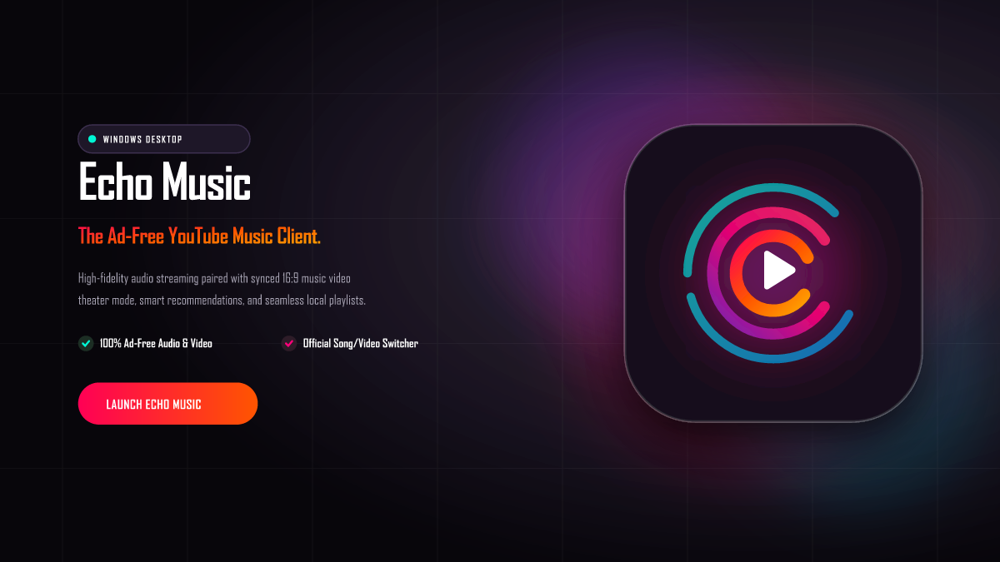
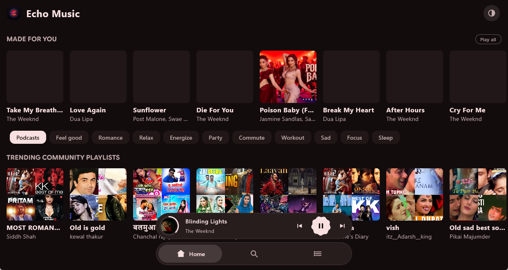
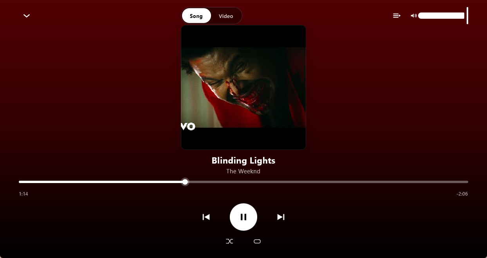
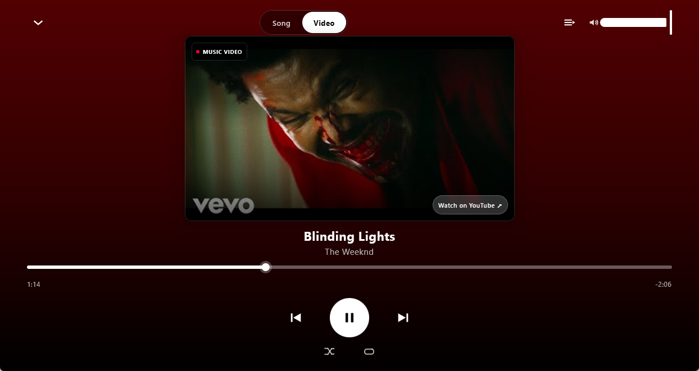
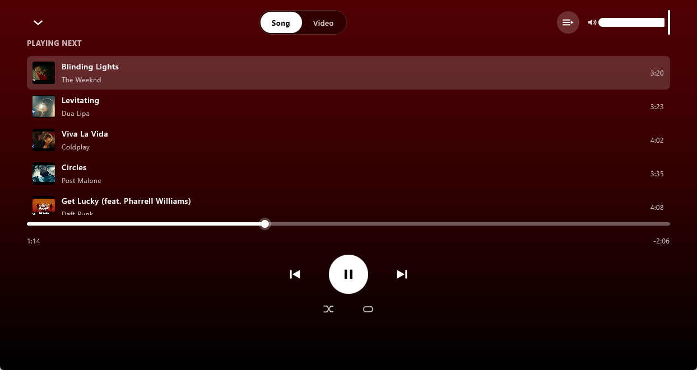
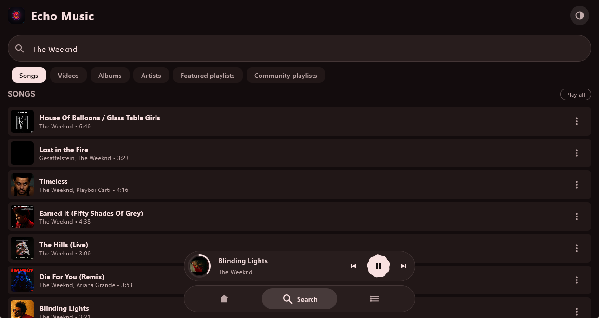
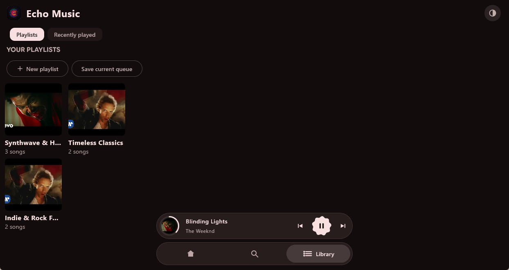

  

  
<b>The official, modern PC desktop client for Echo Music — ad-free YouTube Music streaming, 16:9 theater visuals, lossless audio, dynamic artwork gradients, and zero bloat for Windows.</b>

---

## Overview

**Echo Music Desktop** brings the beloved [Echo Music](https://github.com/EchoMusicApp/Echo-Music) experience natively to Windows PC. Powered by Kotlin and Compose Multiplatform, Echo Music Desktop provides direct access to YouTube Music's entire catalog with zero advertisements, pristine audio quality, and a desktop-optimized interface.

Built from the ground up for desktop listening, it features:
- **Zero Ads**: Stream music continuously without commercial interruptions.
- **Pure Native Desktop Performance**: Hardware-accelerated Skia rendering with low RAM and CPU usage.
- **Dual [Song | Video] Switcher**: Instantly toggle between 1:1 square album art and a cinematic 16:9 theater experience.
- **Auto-Reconnect Audio Engine**: Lossless stream playback with intelligent network dropout recovery and zero desync.
- **Local Playlists & History**: Offline playlist management, taste profile tracking, and complete playback history.

---

## Screenshots

  <table style="margin: 0 auto; border-collapse: collapse;">
    <tr>
      <td align="center" style="padding: 15px; border: none;">
        <b>Home Screen</b>  
        
      </td>
      <td align="center" style="padding: 15px; border: none;">
        <b>Full Player (Song Mode)</b>  
        
      </td>
    </tr>
    <tr>
      <td align="center" style="padding: 15px; border: none;">
        <b>16:9 Theater Mode (Video)</b>  
        
      </td>
      <td align="center" style="padding: 15px; border: none;">
        <b>Playback Queue</b>  
        
      </td>
    </tr>
    <tr>
      <td align="center" style="padding: 15px; border: none;">
        <b>Search & Explore</b>  
        
      </td>
      <td align="center" style="padding: 15px; border: none;">
        <b>Music Library & Playlists</b>  
        
      </td>
    </tr>
  </table>

---

## Features

- **Ad-Free Streaming**: Listen to millions of tracks, albums, and artists without interruptions.
- **Dual Display Modes**: Effortlessly switch between high-resolution album artwork and 16:9 video theater view.
- **Dynamic Palette Backgrounds**: Visuals adapt in real time to the dominant tones of the playing song.
- **Queue & Navigation**: Floating pill navigation, mini-player preview, and comprehensive Up Next queue management.
- **Native Windows Desktop Integration**: Custom branded application icon, window state memory, and keyboard navigation (`Esc` to collapse player, `Space` for play/pause).
- **Personalized Music Library**: Create and organize custom playlists and review your listening history.

---

## Download

Get the standalone Windows installer package (.exe):

> **Direct Download Link:**  
> [Echo-Music-Windows-x64-v1.4.4.exe](https://github.com/dhruvesh07/EchoMusic-Desktop/releases/download/v1.4.4/Echo-Music-Windows-x64-v1.4.4.exe)
